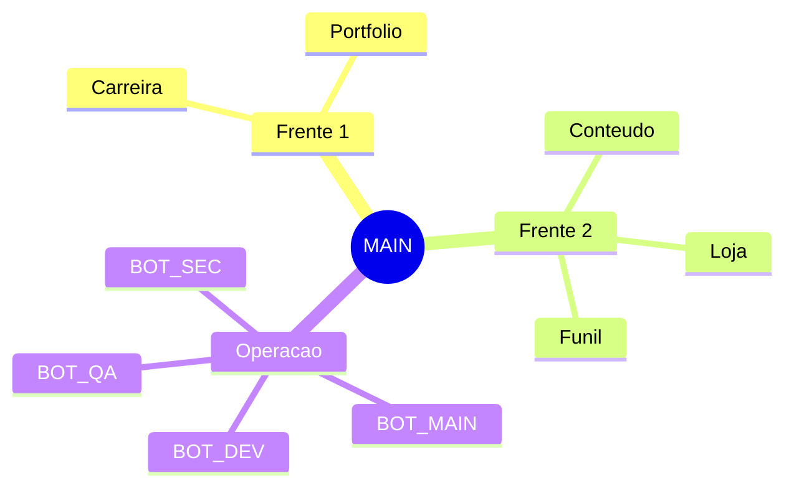
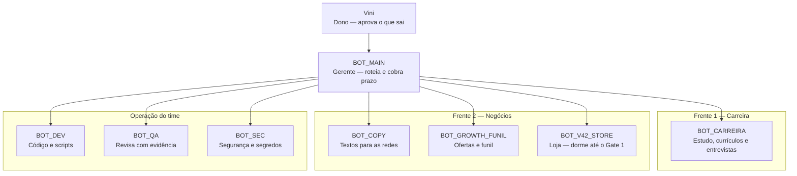
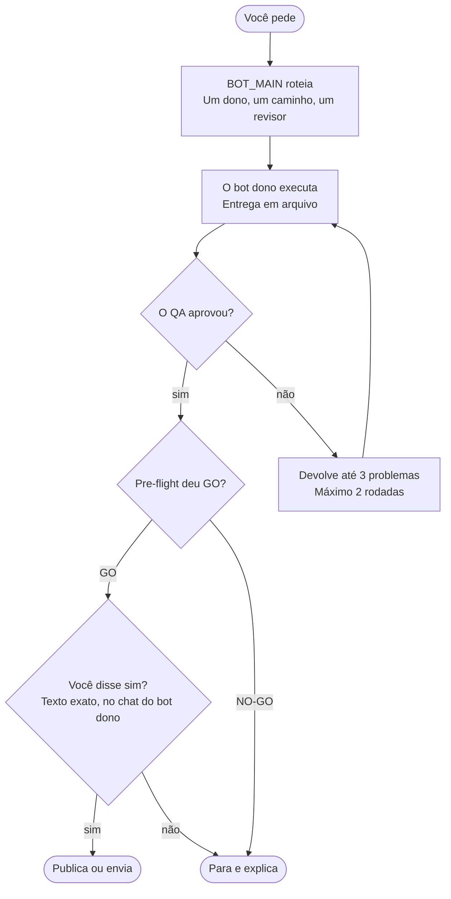
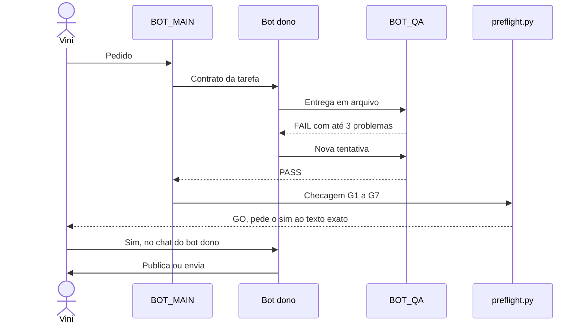
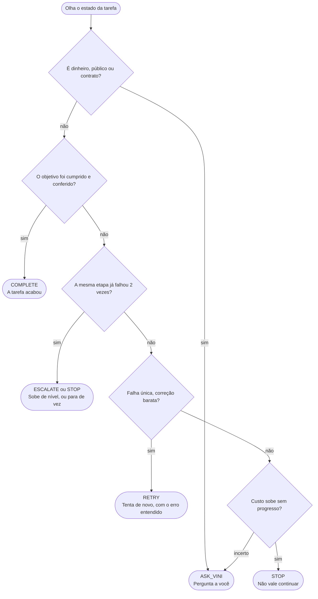
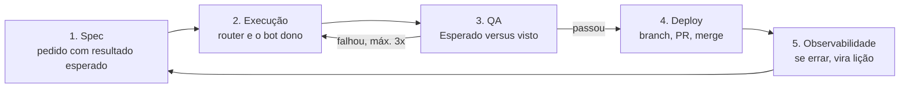
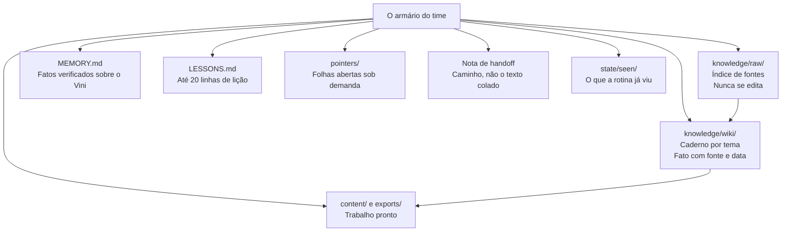
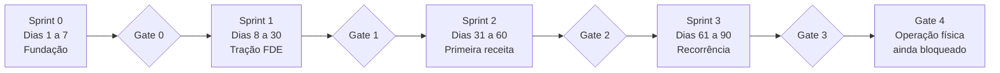
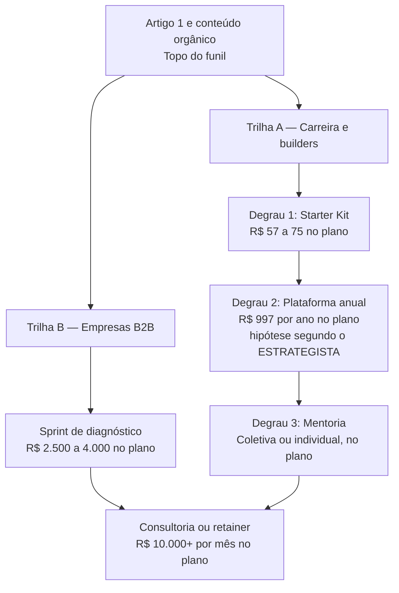

# MAIN — o artigo único do ecossistema

Repositório central **privado** de Luiz Vinicius Alves Pinheiro (`vinipinheiro42/MAIN`): planejamento, memória, prazos, scripts que rodam a custo zero de modelo, e o time de 8 bots.

Este README é o **artigo único** do ecossistema. Ele explica o time, o fluxo de uma tarefa, a memória, a economia de uso, as ofertas, as pastas, os scripts e o que ainda está aberto para o Vini aprovar ou recusar.

Situação descrita em **23 de novembro de 2026**, horário de Brasília (`America/Sao_Paulo`). Este texto está na branch `enrich-x-bookmarks` (pedido de mudança [PR #1](https://github.com/vinipinheiro42/MAIN/pull/1)), ainda não mesclado na `main`. Recomendações do bot ESTRATEGISTA aparecem com esse rótulo: não são decisão do Vini até ele dizer sim. Nada neste artigo aplica sozinho mudanças nos bots vivos, nem publica, nem envia nada.

## Sumário

- [O que é o MAIN](#o-que-é-o-main)
- [Como ler este artigo](#como-ler-este-artigo)
- [Mapa do repositório](#mapa-do-repositório)
- [As duas frentes e as quatro áreas](#as-duas-frentes-e-as-quatro-áreas)
- [O organograma dos 8 bots](#o-organograma-dos-8-bots)
- [Como uma tarefa anda](#como-uma-tarefa-anda)
- [As 7 checagens do pre-flight](#as-7-checagens-do-pre-flight)
- [O gate de decisão](#o-gate-de-decisão)
- [A esteira Loop e JEV](#a-esteira-loop-e-jev)
- [A memória do time](#a-memória-do-time)
- [Como se economiza uso](#como-se-economiza-uso)
- [Scripts do kit e como rodar](#scripts-do-kit-e-como-rodar)
- [Skills, ponteiros e templates](#skills-ponteiros-e-templates)
- [Estado, gates e roadmap de 90 dias](#estado-gates-e-roadmap-de-90-dias)
- [Dinheiro e funil](#dinheiro-e-funil)
- [Documentos, salvos do X e o Artigo 1](#documentos-salvos-do-x-e-o-artigo-1)
- [Quem sobra dos bots atuais](#quem-sobra-dos-bots-atuais)
- [O que você está aprovando](#o-que-você-está-aprovando)

## O que é o MAIN

Imagine uma empresa pequena. Você, Vini (Luiz Vinicius Alves Pinheiro), é o dono. Nada importante sai pela porta sem o seu sim.

O MAIN é o time de bots dessa empresa, e também a pasta onde as regras, a memória e as ferramentas ficam. O gerente se chama `BOT_MAIN`: ele não faz o trabalho todo. Ele encaminha cada pedido para quem sabe fazer, cobra o prazo e impede que o time comece dez coisas ao mesmo tempo.

No Grok Bot de hoje, quem conversa com você como CEO é o bot VINI. O repositório descreve o gerente como `BOT_MAIN`. Os papéis se parecem, mas não são iguais. Sobrescrever o VINI com as instruções do `BOT_MAIN` só acontece se você pedir isso com todas as letras.

O repositório é um **kit portável**: as integrações vivem em conectores e nos arquivos daqui, não presas a um único programa. Os bots foram pensados para rodar no Grok Bot, no Hermes (modelo Qwen local no Omarchy) e em outros ambientes compatíveis.

Arquivos de base, lidos no começo de uma sessão quando fizer sentido:

| Arquivo | Papel |
|---|---|
| `00_SUMARIO.md` | Índice. A regra de ouro: nunca carregue o repositório inteiro. Rode o roteador e abra só 1 ou 2 módulos. |
| `AGENT.md` | Contrato universal de operação. |
| `SOUL.md` | Tom, perfil cognitivo e defesa contra armadilhas de foco. |
| `VALUES.md` | Valores inegociáveis e o que é proibido. |
| `HEARTBEAT.md` | Ritmo do dia, gatilhos rápidos, cobrança de prazo e escalação. |
| `MEMORY.md` | Fatos verificados sobre o Vini. Fonte de verdade do perfil. |
| `LESSONS.md` | Lições curtas (no máximo 20 linhas), lidas no boot. |
| `ECOSYSTEM_MASTER.md` | Plano-mestre: frentes, funil, roadmap de 90 dias e arquitetura técnica. |

## Como ler este artigo

1. Se você quer decidir se a arquitetura do time fica, leia o organograma, o fluxo da tarefa, o gate de decisão e o [checklist no final](#o-que-você-está-aprovando).
2. Se você vai operar o kit, leia o [mapa do repositório](#mapa-do-repositório) e os [scripts](#scripts-do-kit-e-como-rodar).
3. Se você vai falar de ofertas e dinheiro, leia o [funil](#dinheiro-e-funil): o plano do repositório e a recomendação do ESTRATEGISTA estão separados de propósito.

Números de terceiros e preços do plano aparecem como estão nos arquivos-fonte. Hipóteses vêm marcadas. Números relatados por autores de artigos salvos no X não são medições do time do Vini.

## Mapa do repositório

```text
MAIN/
├── README.md                 ← este artigo
├── 00_SUMARIO.md             ← índice para carregar pouco contexto
├── AGENT.md, SOUL.md, VALUES.md, HEARTBEAT.md, MEMORY.md, LESSONS.md
├── ECOSYSTEM_MASTER.md       ← plano-mestre do ecossistema
├── bots/                     ← 8 bots auto-contidos (AGENT.md + bot.yaml)
├── pointers/                 ← PTR-01 a PTR-09, abertos só quando o tema aparece
├── skills/                   ← habilidades portáveis do kit
├── templates/                ← modelos de contrato, handoff, revisão e pre-flight
├── scripts/                  ← ferramentas em Python, custo zero de modelo
├── state/                    ← gates, prazos, sprint, fila de repos, rotinas
├── knowledge/                ← segundo cérebro: raw/ (nunca se edita) e wiki/
├── docs/                     ← salvos do X, mudanças M1–M10, mapa da stack
├── content/                  ← textos prontos, inclusive o Artigo #1
└── exports/                  ← livro compilado (não editar na mão)
```

Cada pasta em `bots/` é um bot especialista no padrão AGH: `AGENT.md` (instruções) + `bot.yaml` (limites, ponteiros autorizados, o que ele não faz, quem revisa). Ele só deve carregar os ponteiros que o `bot.yaml` autoriza.

Topologia oficial de repositórios no GitHub (`github.com/vinipinheiro42`), padrão chamado Opção B:

| Padrão | Visibilidade | Para que serve |
|---|---|---|
| `MAIN` | Privado | Cérebro central: planejamento, currículos, processos seletivos, bots, ponteiros, scripts e prazos. |
| Públicos de jornada (topic `pub-journ-proj`) | Público | Portfólio técnico das 6 funções (FDE, FDDS, AI Engineer, Data Engineer, Data Scientist, Analytics Engineer). Idioma padrão: inglês. Exemplos de slug: `ops-agent-mcp`, `agent-poc-to-prod`, `credit-policy-copilot`. |
| Públicos de negócio (topic `pub-biz-proj`) | Público | Projetos de empreendedorismo, varejo e iscas abertas. Exemplo: `kit-ceo-de-carreira`. |
| `PRIV-PROJ-[NOME]` | Privado | Estudos e trabalhos confidenciais, inclusive o que estiver sob acordo de sigilo. |
| `WORKSPACE-BACKUP` | Privado | Backup estruturado de notas e arquivos pessoais. |

## As duas frentes e as quatro áreas

O repositório oficial organiza o trabalho em **2 frentes**, não em 4 nomes. Frente 1 é carreira. Frente 2 é negócios: conteúdo, funil de ofertas e a loja. `BOT_DEV`, `BOT_QA` e `BOT_SEC` sustentam as duas.

O princípio do plano-mestre é um ativo só, com dois usos: cada hora construindo um agente, um pipeline ou uma análise deve poder virar, ao mesmo tempo, portfólio de carreira, conteúdo técnico, módulo de oferta e ferramenta da loja — quando a fase correspondente estiver liberada.

Uma forma simples de ler as 2 frentes é em 4 áreas. Isso é só uma leitura amigável. Os nomes oficiais continuam sendo Frente 1 e Frente 2.



| Área | O que é | Quem conduz |
|---|---|---|
| Carreira | Estudo, currículos, entrevistas e projetos públicos para vagas (Frente 1). | `BOT_CARREIRA` |
| Marca pessoal | Textos e peças que nascem do trabalho real e vão às redes, só com o seu sim. | `BOT_COPY` |
| Empreendimentos | Ofertas (kit, plataforma, mentoria, B2B) e, depois do Gate 1, a loja de varejo. | `BOT_GROWTH_FUNIL` e, dormente, `BOT_V42_STORE` |
| Operações | Roteamento, código, revisão e segurança, a serviço das outras áreas. | `BOT_MAIN`, `BOT_DEV`, `BOT_QA`, `BOT_SEC` |

## O organograma dos 8 bots



Tabela do kit (papel, ambiente padrão e ponteiros autorizados no `bot.yaml` desta branch):

| Pasta do bot | Papel | Runtime padrão | Ponteiros autorizados | Quem revisa |
|---|---|---|---|---|
| `bots/BOT_MAIN/` | Orquestrador, mentor e cobrador de prazo (SLA) | Grok Bot / qualquer ambiente | PTR-01 a PTR-09 (via `router.py`) | `BOT_QA` |
| `bots/BOT_CARREIRA/` | Frente 1: estudo, 6 currículos, entrevistas e o desenho dos projetos públicos | Grok Bot + Qwen 14B | PTR-01, PTR-05, PTR-07 | `BOT_QA` |
| `bots/BOT_COPY/` | LinkedIn, X, Threads, TikTok, newsletter | Grok Bot | PTR-02, PTR-03, PTR-09 | `BOT_QA` |
| `bots/BOT_DEV/` | Código de ponta a ponta, Docker, esteira de teste, scripts locais | **Hermes / Qwen 14B local (R$ 0)**; reserva: Grok Bot | PTR-01, PTR-05, PTR-08, PTR-09 | `BOT_QA` |
| `bots/BOT_QA/` | Auditoria Esperado versus visto, gate JEV, testes e trava de 3 tentativas | Scripts locais + Qwen 1.5B/14B + `decision_gate.py` | PTR-05, PTR-06, PTR-09 | `BOT_MAIN` |
| `bots/BOT_SEC/` | Segredos, confidencialidade, falhas de segurança e regras de compliance | Scripts locais + Qwen 14B | PTR-05, PTR-06, PTR-09 | `BOT_QA` |
| `bots/BOT_GROWTH_FUNIL/` | Funil de 2 trilhas, pontes, Starter Kit, plataforma, mentoria e B2B | Grok Bot | PTR-03, PTR-02 | `BOT_QA` |
| `bots/BOT_V42_STORE/` | V42 Store: dados de varejo, tendências e canais, começando sem estoque | Qwen 14B local + scripts | PTR-04, PTR-03 | `BOT_QA` |

Até o Gate 1 fechar, o `BOT_V42_STORE` fica em **modo dormente**: observa, não abre operação paralela.

O que cada um faz, o que não faz (`anti_jobs` do `bot.yaml`) e os limites comuns (3 tentativas, 3 passagens; se o mesmo resultado sair 2 vezes, para e escala):

| Bot | Faz | Não faz |
|---|---|---|
| `BOT_MAIN` | Protege o foco, cobra prazos e encaminha cada pedido para o bot certo. | Não escreve o post final (`BOT_COPY`), não programa (`BOT_DEV`) e não revisa a própria orquestração (`BOT_QA`). |
| `BOT_CARREIRA` | Planeja estudo, mantém os 6 currículos a partir da experiência real, ensaiia entrevistas e prepara o desenho dos projetos públicos. | Não envia candidatura sem o sim do Vini, não publica conteúdo (`BOT_COPY`) e não programa o projeto de portfólio (`BOT_DEV`). Não inventa experiência. |
| `BOT_COPY` | Escreve rascunhos para as redes a partir de trabalho real. | Não publica sem o sim do Vini ao texto exato, não define oferta ou preço (`BOT_GROWTH_FUNIL`) e não revisa o próprio texto (`BOT_QA`). |
| `BOT_DEV` | Escreve código, scripts, Docker e esteira de teste. O padrão é o modelo local, que não gasta a cota paga. | Não decide estratégia ou prioridade (`BOT_MAIN`), não publica (`BOT_COPY`) e não aprova o próprio código (`BOT_QA`). |
| `BOT_QA` | Compara o que foi pedido com o que foi entregue, com evidência. Veredito: passou, falhou ou está bloqueado. | Não reescreve a entrega (devolve no máximo 3 problemas por rodada) e não executa a ação que acabou de revisar. No máximo 2 rodadas; na terceira, a decisão vai ao Vini em 3 bullets. Quem escreve não revisa. |
| `BOT_SEC` | Cuida de segredos, acordos de confidencialidade, falhas de segurança e compliance. | Não publica e não altera código de produto (`BOT_DEV`). Pode vetar uma saída se houver risco de vazar dado ou quebrar uma regra do Vini. |
| `BOT_GROWTH_FUNIL` | Desenha o funil, as pontes, o Starter Kit, a plataforma, a mentoria e o trabalho para empresas (B2B). | Não publica (`BOT_COPY`), não gasta com tráfego pago antes do gate de caixa e não contata lead sem o sim do Vini. Proibido recomendar anúncio pago antes de 10 peças orgânicas publicadas e validadas. Proibido construir produto grande antes de validar demanda. |
| `BOT_V42_STORE` | Quando acordar: estuda dados de varejo, tendências e canais, começando sem estoque. | Não compra estoque nem gasta antes do Gate 4, e não publica (`BOT_COPY`). |

## Como uma tarefa anda

Trabalho interno e reversível (rascunho, arquivo no computador do time, branch, pedido de mudança no Git) o bot pode fazer sozinho. O sim do Vini entra quando a ação é pública, envolve dinheiro ou é difícil de desfazer.

Esse sim precisa ser ao **texto exato**, no **chat privado do bot dono do canal**. Um pedido de aprovação feito por outro bot ou por uma rotina expira em cerca de 10 minutos. Em grupo o cartão de aprovação não aparece.



A mesma história, vista no tempo:



Todo pedido entre bots (e um pedido grande do Vini) usa o contrato em `templates/TASK_BRIEF.md`: resultado observável escrito **antes** de começar, o que pode e o que não pode tocar, fontes, formato, caminho de saída e condição de parada. O handoff passa o **caminho do arquivo**, não o conteúdo colado (`templates/HANDOFF_NOTE.md`, no máximo 10 linhas e 3 passagens).

Onde o Vini precisa dizer sim:

- Postar ou enviar qualquer coisa em seu nome (X, LinkedIn e canais públicos).
- Candidatura, e-mail ou formulário que saia da casa.
- Comprar, assinar ou gastar.
- Aceitar proposta, fechar condição de contrato, relocation ou compromisso financeiro.
- Informar pretensão salarial quando não houver orientação prévia dele.
- Apagar dados fora do computador do time, ou criar rotina mais frequente que diária.
- Começar um trabalho grande (mais de 30 minutos, ou muitas páginas e arquivos).

Nível de aprovação, pelo custo de desfazer (`pointers/09_time_de_bots_protocolo.md`):

| Custo de desfazer | Exemplo | Aprovação |
|---|---|---|
| Zero (reversível, interno) | Rascunho, arquivo no computador do time, branch, PR | O bot decide sozinho |
| Baixo | Rotina nova silenciosa, pausar rotina | O bot faz e avisa em 1 linha |
| Alto / público / dinheiro | Post, e-mail, candidatura, compra, apagar dado externo | Sim do Vini ao texto exato, no chat do bot dono, mais `scripts/preflight.py` = GO |

## As 7 checagens do pre-flight

Rodam **no momento da ação**, não horas antes. O gate é binário: um falhou, ou deu erro, e a resposta é não. Isso se chama falha fechada (fail-closed). O método foi adaptado de um artigo salvo no X; o contexto original era trading e **não** foi aplicado. Rejeições vão para `state/preflight_log.jsonl` e entram no ritual semanal.

| Gate | O que confere |
|---|---|
| G1 aprovação | O sim veio no chat do bot dono, com referência ao texto exato. Se o texto mudou depois, precisa de sim novo. |
| G2 destino | A conta ou o destinatário certo foi conferido. |
| G3 confidencial | Nenhum termo proibido (empregadores, clientes, projetos internos). A lista vive em `state/forbidden_terms.local.txt` (fora do Git). Sem esse arquivo, este gate falha fechado de propósito. Há um modelo em `state/forbidden_terms.example.txt`. |
| G4 sensível | Sem CPF, senha, token ou cartão. |
| G5 fatos | Números e afirmações checados contra uma fonte. |
| G6 decisão | Salário, proposta ou relocation só com aprovação explícita. |
| G7 falha fechada | Se qualquer checagem der erro, a ação não sai. |

Como rodar (no time oficial o dono do canal de texto é o `BOT_COPY`; hoje, nos bots vivos, o dono do X ainda pode ser o TWITTER até as mudanças M1–M8 serem aplicadas):

```bash
python scripts/preflight.py --text-file content/drafts/<id>.md --channel x --owner-bot BOT_COPY \
  --approved-in BOT_COPY --approval-ref "<mensagem ou cartão>" --target @vinipinheiro42 \
  --target-confirmed --facts-checked
```

Saída 0 = GO. Saída 1 = NO-GO. Não execute a ação se for NO-GO.

## O gate de decisão

Esse gate **não faz** o trabalho. Ele só escolhe o próximo passo, em uma de cinco respostas: `RETRY` (tenta de novo), `ESCALATE` (passa para outro bot ou para o Vini), `COMPLETE` (acabou), `STOP` (para) ou `ASK_VINI` (precisa do sim). Se a confiança ficar abaixo de 0,85, a saída também é `ASK_VINI`.



Limites do time: no máximo **3 tentativas** e **3 passagens** (handoffs) por tarefa. Se o mesmo resultado aparecer 2 vezes, o bot para e escala — não tenta uma terceira vez à toa. A revisão tem no máximo **2 rodadas**; na terceira, a decisão vem ao Vini em 3 bullets: Origem, Esperado versus Real, Decisão dominante (A ou B).

No time oficial de 8 bots **não existe um nono bot só para decidir**. Quem faz a decisão tipada é o script `scripts/decision_gate.py` (escolha, sim/não ou nota, com confiança). Se o motor não responder, der timeout ou devolver um valor fora da lista, a resposta é não ou escalar, nunca a primeira opção.

Backends do script, pela variável `DECISION_BACKEND`: `heuristic` (padrão, zero token, para teste e ensaio), `ollama` (modelo local pequeno, por exemplo Qwen 1.5B) ou `jev` (API, se `JEV_API_URL` e `JEV_API_KEY` estiverem configurados). O modo sombra (`--shadow`) decide e registra, mas sempre escala: não libera sozinho.

O 0,85 é o limiar para perguntar ao Vini. Os 80% citados pelo ESTRATEGISTA são outro número: o critério sugerido para ligar o modo pago depois de 7 dias de sombra. Não misture os dois.

## A esteira Loop e JEV

O plano técnico do `ECOSYSTEM_MASTER.md` e do `pointers/05_loop_jev_economia_tokens.md` descreve um ciclo em 5 estágios. JEV, aqui, é o padrão de decisão rápida e tipada (System-1), separado dos modelos grandes que geram texto e código (System-2).



1. **Spec.** Toda demanda entra com resultado esperado testável (`expected_outputs`). A fonte da verdade é o Markdown no Git. Se quiser ler em formato de livro, `scripts/build_book.py` gera `exports/MAIN_BOOK_LIVE.md` e, com `pandoc`, um `.docx`.
2. **Execução.** `router.py` escolhe 1 ou 2 ponteiros. `decision_gate.py` ajuda a decidir se a tarefa vai para script (0 token), Qwen local (R$ 0) ou Grok Bot.
3. **QA.** Primeiro uma barreira determinística (testes, linter, checagem de segredos), a custo zero de modelo. Depois a barreira semântica (passou, nota, confiança). Trava de circuito: no máximo 3 voltas; confiança abaixo de 0,85 ou 3 falhas escala ao Vini.
4. **Deploy.** Branch isolada, PR auditado, merge, build reproduzível, atualização de `state/`.
5. **Observabilidade.** Erro ou desvio vira registro em `pointers/06_auditoria_erros.md` e, em uma linha, em `LESSONS.md`. A contramedida preferida é um check em `scripts/`, não um parágrafo a mais no prompt.

O hardware planejado para o modelo local é a RX 7800 XT 16 GB, com Qwen 14B e Qwen 1.5B no Omarchy. A validação disso ainda é um prazo aberto (SLA-005, até 29/11/2026): ainda não está registrada como feita.

## A memória do time

Pense no MAIN como um armário da escola, não como uma conversa infinita. A conversa é a aula de hoje. O que precisa ficar fica no armário, em pastas diferentes, para ninguém ter de reler a mochila inteira a cada pergunta.



Regras do segundo cérebro (`pointers/07_segundo_cerebro.md`):

- Nunca editar `raw/`. Fonte nova entra como arquivo ou linha nova.
- Todo fato no `wiki/` leva fonte e a data da última checagem.
- Se duas fontes discordam, marca-se o conflito. O Vini (ou o bot dono do tema) decide. Ninguém resolve isso em silêncio.
- Número de terceiros não é fato do MAIN: fica atribuído ao autor e, antes de ir a público, passa pelo gate G5.
- Texto bruto de terceiros não vai para o Git. O repositório guarda link e resumo próprio.
- A memória de cada bot guarda preferências, não despejos longos. Texto longo vai para arquivo; a memória guarda só o caminho.

Em 23 de novembro de 2026, as sínteses ainda vivem sobretudo nos ponteiros. O índice `knowledge/wiki/INDEX.md` aponta para eles. Uma página nova no wiki só nasce quando um tema passa de cerca de 150 linhas ou ganha dono próprio. Em `knowledge/raw/` já existe o índice `x-salvos-2026-11-23.md`.

## Como se economiza uso

Uso é, em resumo, quantas vezes o bot roda vezes quanto ele carrega em cada vez. Toda economia ataca um desses dois lados. Na assinatura do X, o chat do Grok, o Grok Bot e os agentes de código saem do **mesmo poço semanal**: o que um desperdiça falta para os outros.

Os 7 vazamentos e a regra do MAIN (`pointers/08_grokbot_uso_economia.md`):

| Vazamento | Regra do MAIN | Ferramenta |
|---|---|---|
| Rotina roda mais vezes que o dado muda | A agenda acompanha a velocidade do dado. Padrão: no máximo 3 execuções por dia. Se existir um evento, use o evento. | `scripts/usage_audit.py` |
| Rotina relê tudo | Arquivo seen: processa só o que é novo, com poda de 30 dias. | `scripts/seen.py`, `state/seen/` |
| Chat longo relido a cada mensagem | Uma conversa por tarefa. Ao trocar de assunto, nota de handoff e chat novo. | `templates/HANDOFF_NOTE.md` |
| Ferramentas ligadas sem uso | Cada bot liga só os conectores do seu trabalho. | Mudança M2, quando aplicada nos bots vivos |
| Navegador quando existe conector | Primeiro script local, depois API ou conector, navegador por último. | `AGENT.md` |
| Dois bots no mesmo trabalho | Um dono por fonte. O que um não faz está escrito no perfil do outro. | `anti_jobs` no `bot.yaml`, PTR-09 |
| Loop sem saída | Toda tarefa tem condição de parada, 3 tentativas e 3 passagens. | `templates/TASK_BRIEF.md` |

Rotina cuja saída ninguém lê deve ser pausada: rotina pausada custa zero. Silêncio é o padrão: “nada novo” não vira mensagem. O botão Test faz trabalho real e consome cota. Em grupo, só o bot citado responde, em 1 a 3 linhas, com ponteiro de arquivo.

No dia do reset do poço, o ritual (`HEARTBEAT.md`) é: inventariar as rotinas (prompt M3), rodar `python scripts/usage_audit.py`, tomar um ajuste por item grave, revisar o log de pre-flight, olhar o modo sombra se estiver ativo, e fazer a higiene do segundo cérebro. Estimativa não é prova. A prova combinada é pausar o suspeito por 24 horas e comparar o percentual da semana. Um autor relata que 84% dos tokens dele eram releitura de chat; esse número é dele, não uma medição do time do Vini.

O inventário `state/routines.json`, em 23 de novembro de 2026, estava **vazio**: nenhuma rotina confirmada foi preenchida ainda. Não se inventa rotina. Só entra o que cada bot confirmar no prompt M3.

Antes de um trabalho grande: conferir o medidor de uso. A regra do MAIN, ajustável, é: acima de 70% do poço com mais de 2 dias até o reset, dividir o trabalho ou passar para o local.

O plano também lista alavancas técnicas de economia: ponteiros por YAML (o roteador corta a maior parte do contexto; o plano fala em 80–90% a menos, como meta do método, não como medição já feita neste time), scripts determinísticos, System-1 local, prefixo estático cacheável com o estado no final do prompt, e passar só o diff, nunca o arquivo inteiro.

## Scripts do kit e como rodar

Todos usam só a biblioteca padrão do Python 3, a custo zero de modelo. Rode a partir da raiz do repositório.

```bash
# 1. Briefing matinal + checagem de prazos + barras dos gates
python scripts/check_sla.py

# 2. Montar o contexto mínimo (ponteiros) para um bot
python scripts/router.py --bot BOT_DEV "implementar loop qa com pytest"
python scripts/router.py --bot BOT_COPY "criar post linkedin e thread x" --bundle

# 3. Testar o motor de decisão (offline, Ollama local ou API JEV)
python scripts/decision_gate.py --self-test
python scripts/decision_gate.py --self-test --shadow --log state/decision_log.jsonl

# 4. Compilar o Markdown do repo em um livro único (+ .docx se o pandoc estiver no PATH)
python scripts/build_book.py

# 5. Auditoria de uso das rotinas (state/routines.json)
python scripts/usage_audit.py
python scripts/usage_audit.py --json
python scripts/usage_audit.py --strict

# 6. Pre-flight antes de qualquer post, envio ou candidatura (binário, fail-closed)
python scripts/preflight.py --text-file content/drafts/<id>.md --channel x --owner-bot BOT_COPY \
  --approved-in BOT_COPY --approval-ref "<msg>" --target @vinipinheiro42 --target-confirmed --facts-checked

# 7. Arquivo seen de uma rotina (processa só o novo)
python scripts/seen.py filter vagas-fde id1 id2 && python scripts/seen.py add vagas-fde id1 id2
python scripts/seen.py stats vagas-fde
```

O que cada um faz:

| Script | Função | Detalhe útil |
|---|---|---|
| `scripts/check_sla.py` | Lê `state/slas.json`, `state/gates.json` e `state/sprint_atual.json` e imprime o briefing do dia. | Sai com código 2 se algum prazo está vermelho (estourado), para um agendador poder alertar. Verde: falta mais de 48 h. Amarelo: 24 h ou menos. Vermelho: prazo passou. |
| `scripts/router.py` | Escolhe os ponteiros certos para a tarefa, a custo zero de modelo. | `--bot` limita aos ponteiros daquele bot. `--bundle` imprime o pacote concatenado. `--full` inclui dependências e arquivos de base. `--max-pointers` limita quantos capítulos entram. |
| `scripts/decision_gate.py` | Decisão tipada (escolha, sim/não, nota) no padrão JEV. | `--backend heuristic\|ollama\|jev`, `--shadow`, `--log`. Se o backend falhar, escala (fail-closed). |
| `scripts/build_book.py` | Compila o repositório em `exports/MAIN_BOOK_LIVE.md`. | Se o `pandoc` existir, também gera `.docx`. Não edite o export na mão. |
| `scripts/usage_audit.py` | Aponta rotinas frequentes demais, sem seen, sem parada, com saída não lida ou com dois donos. | `--json` para saída estruturada. `--strict` sai com código 1 se houver achado grave. |
| `scripts/seen.py` | Filtra, marca e poda o que uma rotina já viu. | Arquivos em `state/seen/<nome>.json` (fora do Git). Poda padrão: 30 dias (`--keep-days`). |
| `scripts/preflight.py` | Gates G1 a G7 no momento da ação. | Canais: `x`, `linkedin`, `email`, `form`, `chat` ou outro. `--sensitive-approved` para G6. `--allow-private-terms` só em canal privado. |

Gatilhos rápidos do `HEARTBEAT.md` (o agente ou o script responde): `bom dia` / `briefing`, `foco`, `sla`, `check gates`, `publicar`, `auditar`, `uso` / `auditar uso`, `preflight`, `fim do dia`.

Se um prazo está vermelho, o time congela as outras frentes e escolhe: cortar o escopo pela metade e entregar uma versão que funciona em até 4 horas, ou registrar o pós-mortem em `pointers/06_auditoria_erros.md` e replanejar. Se está amarelo, essa é a única prioridade do dia.

## Skills, ponteiros e templates

Skills (instruções portáveis em `skills/`):

| Skill | Quando usar | O que faz |
|---|---|---|
| `SKILL_token_router.md` | Rotear, economizar contexto | Nunca carregar o repo inteiro. Primeiro `router.py`, depois só os arquivos que ele devolver (no máximo 2 ponteiros). Estado do sprint vai no **final** do prompt, para não quebrar o cache do prefixo estático. |
| `SKILL_loop_qa_audit.md` | Auditar uma entrega | Extrai a spec, roda a barreira determinística, depois a semântica, e aplica a trava de 3 tentativas. |
| `SKILL_content_from_work.md` | Transformar trabalho real em post | Zero pauta inventada. Um artefato vira LinkedIn + thread no X + roteiro curto, com chamada binária no fechamento. |
| `SKILL_sla_watchdog.md` | Prazo, briefing, gates | Roda `check_sla.py` e cobra o foco único do dia. |
| `SKILL_usage_audit.md` | Dia do reset do poço | Inventário M3, `usage_audit.py`, um ajuste por item grave, prova de 24 h. |
| `SKILL_preflight_externo.md` | Antes de postar, enviar ou se candidatar | Roda `preflight.py` no momento da ação. Sem lista local de termos, o G3 falha. |

Ponteiros (`pointers/`), abertos só quando o tema aparece:

| ID | Arquivo | Domínio |
|---|---|---|
| PTR-01 | `01_fde_fdds_carreira.md` | Frente 1: estudo, 6 currículos, ciclo do projeto público, entrevistas. |
| PTR-02 | `02_conteudo_distribuicao.md` | Conteúdo como subproduto do trabalho real, fases de canal, regra de tráfego pago, critério anti-texto genérico. |
| PTR-03 | `03_funil_infoprodutos_b2b.md` | Escada de ofertas, pontes, validação antes de construir, gates de caixa. |
| PTR-04 | `04_v42_store_ecommerce.md` | Loja, dados de varejo, um canal por vez, bloqueios até os Gates 3 e 4. |
| PTR-05 | `05_loop_jev_economia_tokens.md` | Loop, JEV, hardware local, alavancas de economia. |
| PTR-06 | `06_auditoria_erros.md` | Pós-mortem. Erro que se repete vira check em `scripts/`. |
| PTR-07 | `07_segundo_cerebro.md` | raw → wiki → output, fato com fonte e data. |
| PTR-08 | `08_grokbot_uso_economia.md` | Poço de uso, 7 vazamentos, regras de rotina, auditoria semanal. |
| PTR-09 | `09_time_de_bots_protocolo.md` | Dono, handoff, revisão, pre-flight, quando criar bot novo. |

Templates (`templates/`):

| Modelo | Para quê |
|---|---|
| `TASK_BRIEF.md` | Contrato de uma tarefa. |
| `HANDOFF_NOTE.md` | Passar a tarefa ou abrir chat novo, em até 10 linhas. |
| `BOT_BRIEF.md` | Perfil curto de um bot novo (trabalho, não-faz, conectores mínimos). |
| `GOAL_CONTRACT.md` | Meta de negócio: número, prazo, como medir, quando acaba, prova. |
| `PREFLIGHT.md` | Checklist humano dos 7 gates. |
| `REVIEW_VERDICT.md` | Veredito do revisor: PASS, FAIL ou BLOCKED, com Esperado versus visto. |

Antes de criar um bot novo: uma skill nova resolve? Se não, escrever o perfil pelo `BOT_BRIEF.md`, fazer um piloto só com tarefas reversíveis, e só então pensar em ação externa. Permissão é parede, não só instrução: o que um bot não pode fazer se garante tirando o conector dele, não apenas escrevendo “não faça” no prompt. Todos os bots compartilham o mesmo computador do time. Um bot é fronteira de trabalho, não de segurança. Apagar um bot não limpa os arquivos nem os logins dele.

## Estado, gates e roadmap de 90 dias

O estado vivo fica em `state/` (muda com frequência; não deve ir para o cache estático do prompt no começo):

| Arquivo | Conteúdo |
|---|---|
| `state/gates.json` | Gates de progressão (Estado 0 ao Estado 4) e o que cada um destrava. |
| `state/slas.json` | Prazos com data limite e situação. Fuso: `America/Sao_Paulo`. |
| `state/sprint_atual.json` | Micro-atividades do sprint da semana. |
| `state/repo_queue.json` | Inventário e fila dos repositórios. |
| `state/routines.json` | Inventário das rotinas (preenchido pelo prompt M3; nunca inventado). |
| `state/seen/` | Arquivos seen (fora do Git). |
| `state/forbidden_terms.example.txt` | Modelo da lista local do gate G3. O arquivo de verdade, `forbidden_terms.local.txt`, fica fora do Git. |

Em 23 de novembro de 2026 o sprint era `SPRINT-0-2026-W48` (23 a 30/11/2026). O estado era `ESTADO_0_FUNDACAO`. O foco P0 do dia, no arquivo do sprint, era publicar o Artigo #1 no LinkedIn e no X até 25/11/2026.



| Gate | Nome | Situação em 23/11/2026 | O que precisa para abrir o próximo |
|---|---|---|---|
| GATE-0 | Fundação MAIN + quebra da inércia | Em andamento. O repositório MAIN já existe (SLA-002 concluído). O Artigo #1 e a validação do modelo local ainda não. | Artigo #1 no LinkedIn e no X (e roteiro no TikTok) + Omarchy com Qwen 14B e 1.5B validados na RX 7800 XT. |
| GATE-1 | Tração técnica + prova pública (dias 1–30) | Travado | 8 peças técnicas publicadas; projeto público do loop/JEV em produção com testes, Docker e observabilidade; LinkedIn reformado e 3 currículos prioritários (FDE, FDDS, AI Engineer) ativos. |
| GATE-2 | Primeira receita com caixa inicial zero (R$ 1.500 acumulados) | Travado | Starter Kit no ar com primeiras vendas, oferta de diagnóstico B2B enviada a 20 decisores, receita líquida acumulada de pelo menos R$ 1.500. Destrava API DeepSeek, no plano, até 15% do lucro líquido mensal. |
| GATE-3 | Recorrência (receita mensal recorrente de pelo menos R$ 5.000 por 2 meses) | Travado | Plataforma anual ativa com ponte do degrau 1, turma piloto de mentoria ou 1º contrato B2B, e a recorrência mantida por 2 meses. No plano, destrava ferramentas pagas de produção e o segundo SSD. Vídeo pesado e vários marketplaces ao mesmo tempo só depois deste gate. |
| GATE-4 | Operação física (galpão, confecção, impressão 3D) | Travado | Caixa reservado para pelo menos 6 meses de operação física e 3 linhas de produto com demanda e margem provadas. |

Prazos ativos no mesmo dia (`state/slas.json`):

| SLA | Prazo | Situação | Entrega esperada |
|---|---|---|---|
| SLA-001 | 25/11/2026 | Pendente | Artigo #1 publicado no LinkedIn e no X, sem esperar perfeição visual. |
| SLA-002 | 25/11/2026 | Concluído | Repositório privado `vinipinheiro42/MAIN` no ar, com o kit e os scripts. |
| SLA-003 | 27/11/2026 | Pendente | Versão curta do Artigo #1 no TikTok (65 s). |
| SLA-004 | 28/11/2026 | Pendente | Headline, About e experiências do LinkedIn reformados. |
| SLA-005 | 29/11/2026 | Pendente | Omarchy + modelo local Qwen 14B e 1.5B validados na RX 7800 XT, com benchmark em `MEMORY.md`. |
| SLA-006 | 04/12/2026 | Pendente | Repositório público do projeto 01 (loop + JEV) em inglês, na versão 0.1, com testes e Docker. |

Roadmap linear de 90 dias, como está no plano-mestre (ainda é plano, não um diário do que já aconteceu):

| Janela | Foco no plano |
|---|---|
| Sprint 0 (dias 1–7) | Subir o MAIN, publicar o Artigo #1, reformar o LinkedIn, validar o modelo local. |
| Sprint 1 (dias 8–30) | Projeto público 01 em produção, 8 peças técnicas, 3 currículos prioritários e candidaturas. |
| Sprint 2 (dias 31–60) | Lançar o Starter Kit, oferta de diagnóstico B2B, iniciar a loja em modo zero estoque, meta de R$ 1.500 acumulados. |
| Sprint 3 (dias 61–90) | Plataforma anual, turma piloto de mentoria ou contrato B2B, segundo projeto público, meta de recorrência. |

Canais de conteúdo, no `pointers/02_conteudo_distribuicao.md`, também entram em série para não queimar o time: nos primeiros 30 dias, LinkedIn e X como primários, mais um roteiro curto de TikTok por semana (3 peças de texto por semana + 1 vídeo curto). YouTube e newsletter entram na fase 2. Cortes, UGC e escala pesada de vídeo só no Gate 3. Todo post nasce de trabalho real, dos 45 artigos já curados no legado, ou de padrão técnico sanitizado — nunca de pauta inventada, e nunca de dado interno de cliente ou emprego.

## Dinheiro e funil

Sobre dinheiro, há duas camadas. O plano no repositório descreve uma escada de ofertas com preços. O ESTRATEGISTA deu uma recomendação mais cautelosa. **Nenhuma das duas foi ao ar.**



### Plano no repositório

Valores abaixo estão no `ECOSYSTEM_MASTER.md`. Não são oferta no ar, e o ESTRATEGISTA pede para tratar parte deles como hipótese.

| Trilha | Degrau | Valor no plano |
|---|---|---|
| A — carreira e builders | Starter Kit executável (playbook + arquivos de agente + scripts prontos; não é só PDF) | R$ 57–75 |
| A — carreira e builders | Plataforma anual | R$ 997 / ano (**hipótese**, segundo o ESTRATEGISTA) |
| A — carreira e builders | Mentoria coletiva ou individual | R$ 2.397 / mês (até 8 pessoas) ou R$ 2.997 / mês |
| B — empresas (B2B) | Sprint de diagnóstico | R$ 2.500–4.000, pontual |
| B — empresas (B2B) | Consultoria ou retainer | R$ 10.000+ / mês |

Regras do próprio plano: o degrau 1 precisa ser executável, não só um PDF. Quem compra o kit vê, no plano, uma oferta de upgrade com crédito do valor pago nos primeiros 7 dias. Mentoria coletiva só abre, no plano, com pelo menos 30 compradores dos degraus 1 ou 2, ou 15 leads qualificados em conversa. A conta 8 × R$ 2.397 = R$ 19.176 / mês também está no plano, como conta da turma cheia — não como receita já existente.

Foco B2B, no plano, começa em duas verticais: financeiro / fintechs / seguros, e marketing / comercial / infoprodutos / e-commerce. Outras áreas só depois de 2 cases pagos documentados nessas duas. Validação antes de construir: não gravar um curso inteiro antes de vender; validar o degrau 1 com página simples e pré-venda ou lista de espera de 10 compradores. Programa de afiliados no plano: 35% nos degraus 1 e 2; 10% por 3 meses em indicação B2B fechada.

Tráfego pago, no plano, só depois de orgânico validado e do gate de caixa. É proibido impulsionar post que não teve tração orgânica. A reserva citada é de até R$ 200 / mês, e só no topo de 1 ou 2 peças com melhor sinal, depois de pelo menos 10 peças orgânicas publicadas. A loja permanece dormente até o Gate 1. Começar sem estoque; um canal por vez; importação, vários canais, galpão e impressão 3D só nos gates posteriores, com caixa e margem provadas.

### Recomendação do ESTRATEGISTA

> O método fica grátis e a execução é paga. O Starter Kit só sai quando houver sinal de audiência. Primeiro planilha → dashboard local, depois o pacote FDE; time criativo fica fora por agora. Micro-SaaS só depois de 3 pedidos B2B iguais e da Plataforma validada. JEV começa em modo sombra (M7). Nada foi publicado nem enviado.
>
> — ESTRATEGISTA, posição sobre as 5 perguntas do MAIN (PR #1)

Detalhe dessa recomendação (ainda a validar; não é meta já medida):

- O que fica aberto: critérios, templates, código de portfólio e aprendizados. O que vira produto é a implantação, a adaptação e o kit pronto com setup guiado.
- Sinal de audiência, **hipótese a validar**: cerca de 150 visitas no diagnóstico, 5 pedidos de raio-x e pelo menos 10 pessoas pedindo o Kit.
- Primeira oferta: planilha → dashboard para um negócio local, para gerar 1 ou 2 cases rápidos. Com esses cases, vem o pacote FDE (protótipo → produção).
- Time criativo com bots fica fora por agora.
- Software pequeno vendido por assinatura (micro-SaaS) só depois que 3 clientes pedirem a mesma coisa, e depois da Plataforma validada. O preço de R$ 997 por ano, que aparece no plano, continua sendo hipótese.
- O gate de decisão pago (JEV) primeiro roda 7 dias em modo sombra, só registrando. O pago só entra com pelo menos 80% de acerto e uma economia real de uso.

Próximos passos que o ESTRATEGISTA se ofereceu a fazer, se o Vini topar: registrar esses gatilhos no repositório como hipóteses; escrever a oferta planilha → dashboard, sem preço, para o Vini aprovar; ligar o modo sombra. São recomendações, não ordens.

## Documentos, salvos do X e o Artigo 1

Em `docs/`:

| Arquivo | O que é |
|---|---|
| `docs/ENRIQUECIMENTO-SALVOS-X.md` | Catálogo das fontes: o que cada artigo ou post salvo no X enriquece no MAIN, e como. É a trilha de evidência das regras novas desta branch. |
| `docs/MUDANCAS-PARA-APLICAR.md` | Texto exato das mudanças M1 a M10 para os **bots, rotinas e skills vivos**. Este repositório **não** as aplica sozinho. |
| `docs/MAPA-STACK-NEGOCIO-DIGITAL.md` | Mapa de termos de negócio digital (funil, CAC, MRR, anúncios e outros) para onde cada um cabe nas frentes, quem é o dono e qual é o próximo passo. A leitura de mentor do próprio mapa: agora, engenharia de prompts, APIs, automações, modelo local, texto e funil no orgânico; métricas de receita quando houver venda; anúncios só com orgânico provado e gate de caixa. |

Resumo das mudanças M1 a M10 (o texto exato está no documento acima; aplicar é decisão do Vini, item a item):

| # | Mudança | Aprovação |
|---|---|---|
| M1 | Regras comuns a todos os bots (“pergunte antes”, economia, 3 tentativas). | Vini (muda o comportamento de todos). |
| M2 | Bloco comum de perfil: faz, não-faz, conectores mínimos. | Vini, junto com a atualização dos bots. |
| M3 | Prompt de inventário de rotinas (só leitura). | Nenhuma: é leitura. As respostas vão para `state/routines.json`. |
| M4 | Proposta de um bot ROTINAS dedicado, para não inflar o chat dos outros. | **Decisão do Vini.** Só vale se o inventário M3 mostrar rotinas espalhadas. |
| M5 | Regras de group chat (só responde se for citado, em até 3 linhas). | Vini, junto com M2. |
| M6 | Atualização de 4 skills vivas (contrato de tarefa, revisão com evidência, gate de decisão, auditoria de uso). | Vini, junto com M2. |
| M7 | DECISOR em modo sombra por 7 dias (registra, não libera sozinho). | Vini. |
| M8 | Handoff para chat novo nas conversas longas. | Vini, junto com M2. |
| M9 | WhatsApp no computador do time. | **Decisão do Vini; não recomendado agora.** Há risco à conta e exposição de conversas privadas num computador compartilhado. Nenhum fluxo do MAIN depende de WhatsApp hoje. |
| M10 | Possíveis donos duplicados: MONETIZAÇÃO × CAÇADOR DE MONETIZAÇÃO, e NEGÓCIO AUTOMATIZADO × AUTOMAÇÃO B2B. | **Decisão do Vini.** Nesse passo nada é apagado: define-se um dono por fonte. |

O **Artigo #1** está em `content/01_artigo_setup_jornada_fde.md`. É o texto público da jornada (hardware, dual boot Windows + Omarchy, IA local a custo de caixa zero, ciclo FDE/FDDS). Tem 3 versões prontas: artigo ou post longo no LinkedIn, thread de 9 posts no X, e roteiro de 65–75 segundos para TikTok ou Reels, sem produção pesada. Status no arquivo: pronto para publicar. Prazo: 25/11/2026 no LinkedIn e no X (SLA-001), e 27/11/2026 no TikTok (SLA-003). Em 23 de novembro de 2026, ainda não estava marcado como publicado. Este README **não** substitui esse artigo: ele continua sendo o texto de publicação, e só sai com o sim do Vini ao texto exato mais o pre-flight em GO.

## Quem sobra dos bots atuais

A ordem do Vini foi: reaproveitar os bots atuais, criar o que falta, e ver quem sobra antes de apagar. O repositório MAIN **não pede a exclusão de ninguém**. A lista abaixo é o mapa de 23 de novembro de 2026 (`MAIN-plan/bot-diff.md`, fora deste repo): sobreposição de papel, não uma ordem de apagar.

Candidatos a reaproveitar (inferência de papel, não uma confirmação do repositório):

| Bot oficial | Candidato atual mais próximo | Observação |
|---|---|---|
| `BOT_MAIN` | VINI (CEO) | Os papéis se sobrepõem, mas não são idênticos. Não sobrescrever o CEO sem decisão explícita do Vini. |
| `BOT_CARREIRA` | Os 6 bots de cargo, e parte do ESTRATEGISTA | O repo pede um bot de carreira, não seis. |
| `BOT_COPY` | LINKEDIN e TWITTER | Um bot só, para todos os canais de texto. |
| `BOT_DEV` | DEV DE BOTS | É o par mais próximo. |
| `BOT_QA` | REVISOR | É o par mais próximo da auditoria com evidência. |
| `BOT_SEC` | Nenhum claro | Candidato a criar. |
| `BOT_GROWTH_FUNIL` | MONETIZAÇÃO, AUTOMAÇÃO B2B, NEGÓCIO AUTOMATIZADO | Um bot só no repo. |
| `BOT_V42_STORE` | Nenhum direto | Candidato a criar, em modo dormente até o Gate 1. |
| Script de decisão (não é bot) | DECISOR | No repo, a decisão tipada é um script, não um bot da pasta `bots/`. |

Sem assento direto no time de 8:

| Bot atual | Por que não tem correspondente direto |
|---|---|
| SEO LOCAL | SEO local não aparece no time nem nos ponteiros. |
| RAG CORPORATIVO | Não é um bot do kit oficial. |
| TRÁFEGO PAGO | O plano proíbe anúncio pago antes de orgânico validado e do gate de caixa. Não há bot oficial para isso agora. |
| CAÇADOR DE MONETIZAÇÃO | Monetização fica concentrada no `BOT_GROWTH_FUNIL`. Ver também M10. |
| CONTEÚDO EM VÍDEO | Vídeo pesado está bloqueado até o Gate 3. Na fase atual, o `BOT_COPY` só pede roteiro curto. |
| FORWARD DEPLOYED ENGINEER, FORWARD DEPLOYED DATA SCIENTIST, AI ENGINEER, DATA ENGINEER, DATA SCIENTIST, ANALYTICS ENGINEER | O repo unifica os 6 currículos e o estudo em um único `BOT_CARREIRA`. |
| LINKEDIN e TWITTER | O repo unifica os canais no `BOT_COPY`. |
| MONETIZAÇÃO, AUTOMAÇÃO B2B, NEGÓCIO AUTOMATIZADO | Papéis cobertos pelo `BOT_GROWTH_FUNIL` (e, depois do Gate 1, pelo `BOT_V42_STORE`). Ver M10. |
| ESTRATEGISTA e DECISOR | Roteamento e gates ficam no `BOT_MAIN` e no script de decisão. O ESTRATEGISTA ainda é consultado quando o Vini pede. |

O que acontece com eles: continuam no ar até o Vini decidir. Nada é apagado sem o sim dele. Se ele quiser enxugar, ele mesmo apaga no menu do Grok Bot, depois de conferir este artigo e a decisão M10.

## O que você está aprovando

Situação em 23 de novembro de 2026, horário de Brasília. Os itens abaixo estão **abertos**. Este README não registra o sim: ele só mostra o que ainda falta decidir.

- [ ] Mesclar o PR #1 no repositório MAIN
- [ ] Aplicar M1 a M8 nos bots e skills vivos
- [ ] Decidir M4: criar ou não o bot ROTINAS
- [ ] Decidir M9: WhatsApp no computador do time (não recomendado agora)
- [ ] Decidir M10: possíveis donos duplicados, sem apagar ninguém ainda
- [ ] Criar o arquivo local `state/forbidden_terms.local.txt`
- [ ] Apagar, ou manter, os bots que sobram
- [ ] Seguir, ou não, os próximos passos recomendados pelo ESTRATEGISTA

| Decisão | Se você aprovar | Risco se não aprovar |
|---|---|---|
| Mesclar o PR #1 | Entram no repositório o segundo cérebro, o pre-flight, a auditoria de uso, os ponteiros 07 a 09, os templates, os anti-jobs dos 8 bots e este artigo no README. O PR sozinho não muda os bots vivos. | O time vivo e o repositório ficam dessincronizados. Pre-flight, memória nova e auditoria de uso permanecem só na branch. |
| Aplicar M1 a M8 nos bots vivos | As regras comuns, o protocolo de grupo, o handoff para chat novo, as skills atualizadas e o modo sombra do DECISOR (M7, 7 dias só registrando) passam a valer no dia a dia. | O repo descreve o protocolo, mas os bots vivos seguem o hábito antigo. Os vazamentos de uso continuam. |
| M4 — bot ROTINAS | As rotinas agendadas saem dos bots de conversa e concentram-se em um bot que só executa, avisa em 1 linha quando há novidade, e não publica nada. | Se as rotinas estiverem espalhadas, o contexto de rotina continua inchando as conversas. Criar o bot agora, sem o inventário M3, é ter um bot a mais sem prova de que vale a pena. |
| M9 — WhatsApp | O WhatsApp Web rodaria no computador do time, para listar quem espera resposta e rascunhar. Só faria sentido com regra prévia: rascunho sempre; envio só com o sim, e um bot só. | Não aprovar é o caminho recomendado agora. O próprio autor do método declara risco à conta, e conversas privadas ficariam num computador compartilhado por todos os bots. Nenhum fluxo do MAIN depende de WhatsApp hoje. |
| M10 — donos duplicados | O Vini pergunta a cada par qual é o trabalho em uma frase e quais rotinas tem, e define um dono por fonte, com anti-job no outro. Nada é apagado nesse passo. | Dois bots podem continuar fazendo o mesmo trabalho e queimando uso. Enxugar o time sem essa conversa aumenta o risco de apagar o dono certo. |
| Criar `forbidden_terms.local.txt` | O Vini copia o exemplo e preenche, fora do Git, com os nomes que não podem ir a público. Este artigo não lista esses nomes. Aí o gate G3 passa a funcionar de verdade. | Sem o arquivo, o pre-flight falha fechado no G3. Ou ninguém consegue um GO, ou alguém pularia a checagem — os dois são ruins. |
| Apagar os bots que sobram | O time fica mais perto dos 8 oficiais, com menos risco de dois donos na mesma fonte. O Vini mesmo apaga, depois de olhar o mapa e a M10. | Manter todos custa uso e confunde dono. Apagar cedo demais, sem a M10, pode remover um papel que o Vini ainda quer. |
| Próximos passos do ESTRATEGISTA | Registrar os gatilhos de audiência como hipóteses; escrever a oferta planilha → dashboard, sem preço, para o Vini aprovar; ligar o modo sombra do gate por 7 dias. | O plano do repositório segue com a escada de preços e o Kit no Gate 2, mesmo sem sinal de audiência medido. O Vini pode recusar, aceitar em partes, ou pedir outro desenho. |

Se quiser, o próximo passo é dizer quais desses oito itens valem, quais não valem, e o que deve ser aplicado de fato. Enquanto isso, os bots vivos e a branch `main` permanecem como estão.

---

Como este repositório nasceu (registro do primeiro push; o remoto já existe, não é para rodar de novo numa cópia que já tem `origin`):

```bash
cd MAIN
git init -b main
git add .
git commit -m "feat: bootstrap MAIN portable bot harness, ecosystem master plan and article 01"
git remote add origin git@github.com:vinipinheiro42/MAIN.git
git push -u origin main
```
